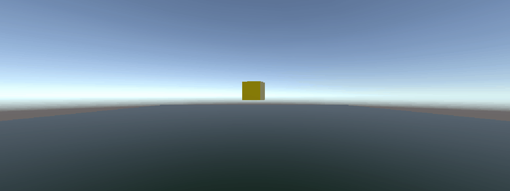
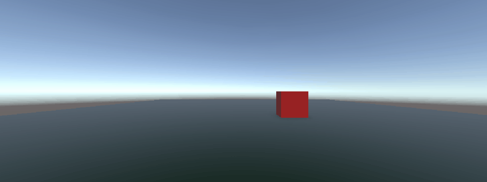
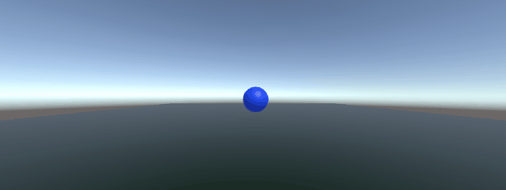
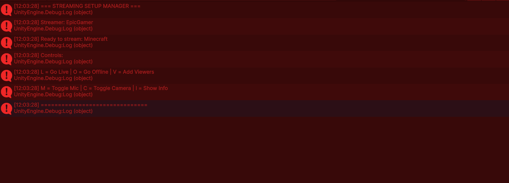
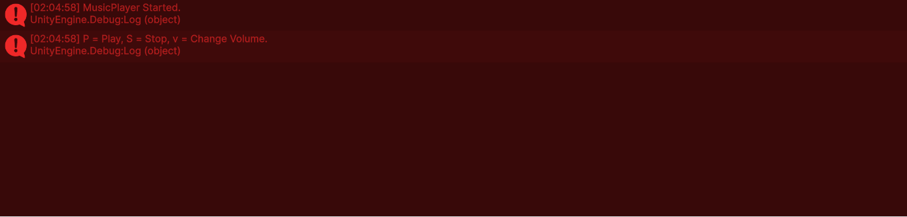
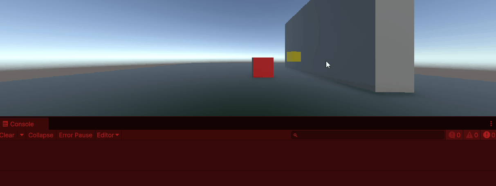
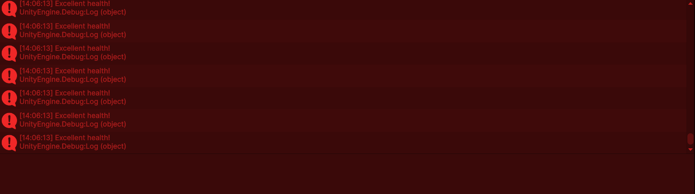
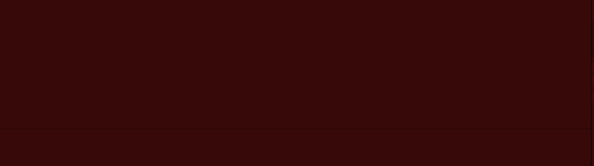
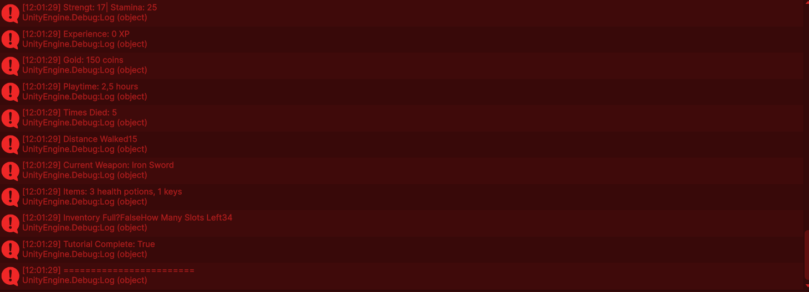

# 1

ik heb een transom.rotate gebruikt op een object te laten draaien 

[CoinRotation](Assets/Scripts/M1/CoinRotation.cs)

# 2 

ik heb met een transform.position een object heen en weer laten bewegen

[MoveSideToSide](Assets/Scripts/M1/MoveLR.cs)

# 3

ik heb met een transform.rotateAround om een punt laten roteren

[MoveCirle](Assets/Scripts/M1/MoveCircle.cs)

# 4

ik heb een sort streamer dashboard gemaakt door gebruik van datatypes en variabelen

[StreamingManager](Assets/Scripts/M1/StreamingManager.cs)

# 5

door het bebruik van variabelen en datatypen heb ik music speler systeem gemaakt

[text](Assets/Scripts/M1/MusicPlayer.cs)

# 6

ik heb een object laten bewegen als je wasd indrukt en je kan muntjes opakken. je kan niet door muren heen

[Player](Assets/Scripts/M1/PlayerMove.cs)

# 7

ik heb een systeem gemaakt die de health checked

[Check Health](Assets/Scripts/M1/HealthStatus.cs)

# 8

ik heb een systeem gemaakt waarin je van verschilende wapens kan kiezen

[WeaponSwitch](Assets/Scripts/M1/WeaponSwitch.cs)

# 9

ik heb een systeem gemaakt waarby je de peler statieken bijhoud

[playerstats](Assets/Scripts/M1/PlayerStats.cs)

# M6

# 02 Class Diagrams

[ClassDiagramTD](ClassDiagramTD.md)

# 07 Early returns

ik heb de code meer leesbaar gemaakt

[BreakPyramid](Assest/Scripts/M6/BreakPyramid.cs)

